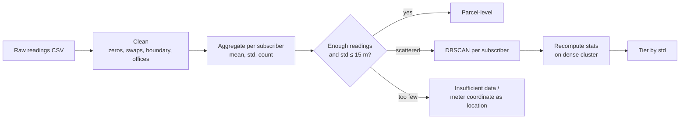

# Subscriber Geolocation Accuracy

Cleans noisy field GPS readings, estimates **one location per subscriber** (`bill_ID`), and classifies how accurate each estimate is: **parcel**, **block** or **regional** level.

> **Input note:** the source Access database must be exported to CSV before running. See [docs/runbook.md](docs/runbook.md#2-prepare-the-inputs).

---

## What it does

1. **Cleans** raw readings: zero coordinates, swapped meter X/Y, points outside the city boundary, readings taken inside electricity offices.
2. **Aggregates** the readings of each subscriber into a mean position and a spread (combined standard deviation, in metres).
3. **Rescues scattered subscribers** with per-subscriber DBSCAN clustering, discarding stray readings and recomputing the statistics.
4. **Classifies** every estimate into an accuracy tier and writes categorized CSV files.
5. **Reports** with charts and a comparison against the previous processing phase.

| Tier | Persian | Rule (combined std, metres) |
|---|---|---|
| Parcel-level | دقت قطعه‌ای | ≤ 15 |
| Block-level | دقت بلوکی | > 15 and ≤ 45 |
| Regional | دقت منطقه‌ای | > 45 |

Subscribers with fewer than 6 usable readings are not estimated. They go to *insufficient data*, or, when the meter coordinate is known, the meter coordinate is used as their location.

## Pipeline at a glance



Full detail: [docs/pipeline.md](docs/pipeline.md).

## Repository layout

```
.
├── README.md
├── requirements.txt
├── LICENSE
├── .gitattributes
├── .gitignore
├── docs/                       # all documentation (see index below)
├── notebooks/
│   ├── 01_full_pipeline.ipynb  # the complete pipeline (was modified.ipynb)
│   └── archive/
│       └── prototype_preprocessing.ipynb   # early prototype (was automated.ipynb)
└── workspace/                  # git-ignored: inputs, intermediates, outputs per district
    └── d10/
```

## Quick start

```bash
git clone https://github.com/soroushyasini/subscriber-geolocation-accuracy.git
cd subscriber-geolocation-accuracy

python -m venv .venv
source .venv/bin/activate            # Windows: .venv\Scripts\activate
python -m pip install -r requirements.txt
python -m nbstripout --install --attributes .gitattributes

mkdir -p workspace/d10               # put the input files here (see runbook)
jupyter lab notebooks/01_full_pipeline.ipynb
```

Run the notebook **top to bottom, once**. Step-by-step instructions, checkpoints and troubleshooting are in the [runbook](docs/runbook.md).

## Inputs

| Input | Format |
|---|---|
| Readings table (exported from Access) | CSV with `district, bill_ID, agent_x, agent_y, counter_x, counter_y` |
| City boundary | Shapefile |
| Electricity-office polygons | Shapefile |
| Previous-phase results | DBF files with a `BILL_IDENT` column |

Coordinates are UTM zone 39N (EPSG:32639), in metres.

## Documentation

| Document | Read it to… |
|---|---|
| [docs/pipeline.md](docs/pipeline.md) | Understand the architecture, every stage, parameters and packages |
| [docs/methodology.md](docs/methodology.md) | Understand *why* it works, with a worked example |
| [docs/data-dictionary.md](docs/data-dictionary.md) | Look up columns, intermediate files and outputs |
| [docs/runbook.md](docs/runbook.md) | Run it, check it and fix common problems |
| [docs/known-issues.md](docs/known-issues.md) | See caveats and the refactoring roadmap |

## Data privacy

Subscriber identifiers and coordinates are personal data. **Do not commit real data**: inputs, intermediates and outputs live in `workspace/` (git-ignored). The published notebooks have been cleared of saved outputs and embedded subscriber IDs. Install the output-stripping filter in each clone and review notebook source before committing (see the runbook).

Earlier commits still contain subscriber data. The repository remains public by owner choice; cleaning the current files does not remove that historical exposure. History cleanup is a separate pending task.

## Author

Soroush Yasini

## License

Licensed under the [MIT License](LICENSE). Copyright (c) 2026 Soroush Yasini.
