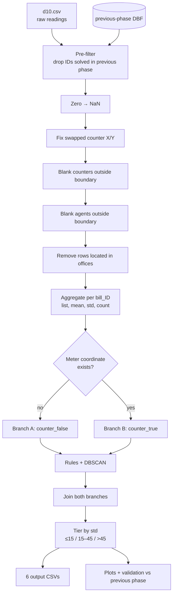
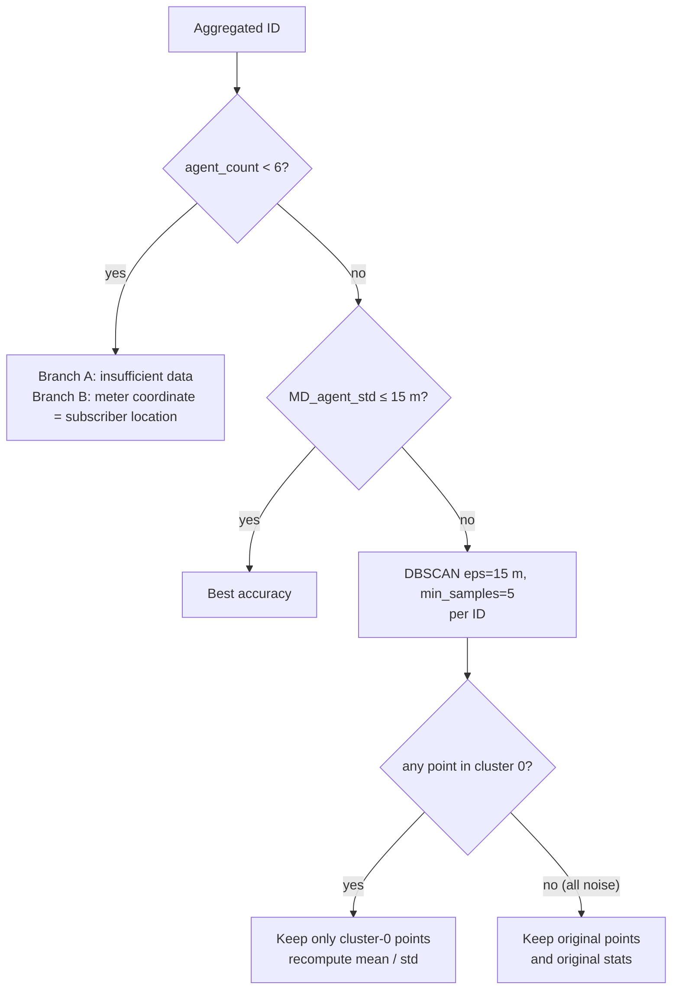

# Subscriber Location Accuracy Pipeline — Developer Documentation

| | |
|---|---|
| **Source** | `notebooks/01_full_pipeline.ipynb` (formerly `modified.ipynb`), Python 3.12 kernel |
| **Repository** | https://github.com/soroushyasini/subscriber-geolocation-accuracy |
| **Author** | Soroush Yasini |
| **Scope** | District 10 data (`d10.csv`), incremental phase on top of a previous accuracy phase |
| **Audience** | Developers / analysts onboarding to the project |
| **Doc status** | Derived from the notebook's code and saved outputs — see [§11 Assumptions to verify](#11-assumptions-to-verify) |

---

## Table of contents

1. [Overview](#1-overview)
2. [Objective](#2-objective)
3. [Glossary](#3-glossary)
4. [Data](#4-data)
5. [Architecture](#5-architecture)
6. [Stage-by-stage walkthrough](#6-stage-by-stage-walkthrough)
7. [Algorithms, thresholds and parameters](#7-algorithms-thresholds-and-parameters)
8. [Packages and why they are used](#8-packages-and-why-they-are-used)
9. [Files and folder layout](#9-files-and-folder-layout)
10. [Results recorded in the notebook](#10-results-recorded-in-the-notebook)
11. [Assumptions to verify](#11-assumptions-to-verify)

See also: [runbook](runbook.md) · [methodology](methodology.md) · [data dictionary](data-dictionary.md) · [known issues](known-issues.md)

---

## 1. Overview

The notebook takes a large table of **field readings** (GPS positions recorded by field agents while visiting subscribers, plus the meter's own coordinates when available) and turns it into **one estimated location per subscriber (`bill_ID`)**, together with a **confidence tier** for that estimate.

In one sentence: *clean noisy GPS readings, estimate where each subscriber is, and label how trustworthy that estimate is.*

The pipeline is fully script-like: a linear notebook that reads CSV / Shapefile / DBF inputs, writes many intermediate CSV and JSON files, and finishes with six categorized output CSVs, summary plots and a validation against the previous phase.

### Notebooks in this repository

| Notebook | Role |
|---|---|
| `notebooks/01_full_pipeline.ipynb` (was `modified.ipynb`) | **The complete pipeline** documented here: cleaning, aggregation, branching, DBSCAN, tiering, reporting, validation |
| `notebooks/archive/prototype_preprocessing.ipynb` (was `automated.ipynb`) | **Earlier prototype.** About 77 cells; starts to move logic into functions but stops after per-subscriber aggregation (`reorg.json`). It has no DBSCAN, no tiering and no final outputs. See [known issues](known-issues.md#2-repository-and-process-issues) for how it differs |

---

## 2. Objective

**Primary goal.** For every subscriber that has not already been resolved with parcel-level accuracy in the previous phase, derive a best-estimate coordinate and classify its accuracy as one of:

| Tier (Persian name) | English meaning | Rule (combined std, metres) |
|---|---|---|
| دقت قطعه‌ای (*daghat-e gheteh-ee*) | Parcel-level accuracy | σ ≤ 15 |
| دقت بلوکی (*daghat-e bolooki*) | Block-level accuracy | 15 < σ ≤ 45 |
| دقت منطقه‌ای (*daghat-e mantaghe-ee*) | Regional / zone-level accuracy | σ > 45 |

Subscribers that cannot be estimated reliably are routed to dedicated buckets (insufficient data, meter coordinate used as location, readings taken at offices).

**Secondary goals.**

* Detect and repair data-entry problems (zero coordinates, swapped X/Y on meter coordinates).
* Remove geographically impossible points (outside the district boundary, or inside electricity-office polygons).
* Use clustering (DBSCAN) to recover accurate locations for subscribers whose readings are scattered because of a few outliers.
* Measure how many previously low-accuracy subscribers were upgraded in this phase.

---

## 3. Glossary

| Term | Meaning in this project |
|---|---|
| `bill_ID` / `ID` | 13-digit subscriber (bill) identifier. The unit of analysis. Cast to `int64` when compared with the previous-phase DBF. |
| **agent** (`agent_x`, `agent_y`) | The position recorded by the field agent / reader's device at the time of a reading. Many readings per `bill_ID`. |
| **counter** (`counter_x`, `counter_y`) | The subscriber's **meter** (Persian: کنتور) coordinates. Often missing. The English word "counter" in the code means *meter*. |
| **record** | One row of the raw table: one agent reading for one `bill_ID`. |
| `agent_count` | Number of valid (non-NaN) agent readings for an ID. |
| `MD_agent_std` | Combined spread of an ID's agent readings: `round(sqrt(σx² + σy²))`, in metres. The notebook does not define the `MD_` prefix. |
| **Best accuracy** | IDs with `agent_count ≥ 6` and `MD_agent_std ≤ 15` *before* any clustering. |
| **Office** | Polygons of electricity offices (`offices.shp`). Readings located inside them are not field positions and are discarded. |
| **Previous phase** | Earlier processing run whose parcel-level result is `دقت_قطعه_ای.dbf`. Those IDs are excluded here. |
| **Cluster 0 / −1** | DBSCAN labels. `0` = first cluster found; `−1` = noise. |

---

## 4. Data

### 4.1 Inputs

| Input | Path (as in notebook) | Format | Purpose |
|---|---|---|---|
| Raw access table | `d10.csv` | CSV | The main dataset: one row per agent reading |
| District boundary | `T6/T6.shp` | Shapefile | Valid area; points outside are treated as outliers |
| Electricity offices | `offices/offices.shp` | Shapefile | Polygons where readings are invalid |
| Previous-phase parcel-level IDs | `دقت_قطعه_ای.dbf` | DBF | IDs already solved; removed from this phase |
| Previous-phase block / regional IDs | `دقت_بلوکی.dbf`, `دقت_منطقه_ای.dbf` | DBF | Only used at the end to validate how many IDs improved |

### 4.2 Raw table schema (`d10.csv`)

| Column | Type | Notes |
|---|---|---|
| `district` | int | Dropped immediately (constant: 10 in the sample) |
| `bill_ID` | int64 (13 digits) | Subscriber identifier, repeated across readings |
| `agent_x`, `agent_y` | float | UTM easting / northing of the agent reading |
| `counter_x`, `counter_y` | float | UTM easting / northing of the meter; frequently `NaN`; sometimes swapped; sometimes `0` |

Sample rows (synthetic values with the same shape as the real data):

```
bill_ID        agent_x   agent_y    counter_x  counter_y
1000000000011  500200.0  3900100.0  500196.0   3900126.0
1000000000022  500200.0  3900100.0  NaN        NaN
1000000000033  500190.0  3900215.0  500395.0   3900288.0
```

### 4.3 Coordinate system

* All coordinates are **UTM zone 39N, WGS84 (EPSG:32639)**, in **metres**.
* Because they are metric, distances and standard deviations are directly in metres, and DBSCAN's `eps=15` means 15 m.
* Conversion to latitude/longitude happens **only for the Folium QA maps**; the pipeline itself stays in UTM.

### 4.4 Data problems the pipeline handles

| Problem | Handling |
|---|---|
| Missing coordinates encoded as `0` | `replace(0, NaN)` over the whole table |
| Meter X/Y swapped (X holds the northing) | Swap if `counter_x > 900000` **and** `counter_y < 1000000` |
| Meter coordinates outside the district | Set to `NaN` (row is kept, only the meter coordinates are blanked) |
| Agent coordinates outside the district | Set to `NaN` |
| Readings taken inside an electricity office | Row removed and saved separately |
| IDs already solved in the previous phase | Excluded up front |

---

## 5. Architecture

### 5.1 High-level pipeline



### 5.2 Per-branch decision logic (identical for both branches)



### 5.3 Design idea in plain words

1. **Clean first, aggregate second.** All geometric cleaning is done row by row before any statistics are calculated.
2. **Spread = confidence.** If many readings for one subscriber agree within a few metres, the mean is trustworthy; if they scatter, it is not.
3. **Rescue scattered IDs with clustering.** If scatter comes from a few bad readings, DBSCAN isolates the dense group; statistics are recomputed on that group alone.
4. **Two branches by meter availability.** When a meter coordinate exists it is carried along and can serve as the location when there are too few agent readings.
5. **Everything is file-based.** Each step writes CSV/JSON and the next step reads it back. This makes every intermediate result inspectable but couples the cells tightly (see [known issues](known-issues.md#1-code-and-method-caveats)).

---

## 6. Stage-by-stage walkthrough

### Stage 0 — Setup

* Imports (see [§8](#8-packages-and-why-they-are-used)); `warnings.filterwarnings("ignore")`.
* **User-provided paths:** `dist_shape`, `offices`, `access_db`.
* Reads the raw table into `access_df`.

### Stage I — Pre-processing

| Step | What it does | Main outputs |
|---|---|---|
| I.1 Drop `district` | Removes the constant column | — |
| I.2 Count | Records and unique IDs stored in `R_…` variables for the final report | `R_access_*` |
| I.3 Pre-filter by previous phase | Reads `BILL_IDENT` from `دقت_قطعه_ای.dbf` and removes those IDs from the raw table | `filtered_by_dbscan_zer2null.csv` (zeros already converted to `NaN`) |
| I.4 Fix inverted meter coordinates | Swaps `counter_x`/`counter_y` where the pattern indicates X holds the northing | `filtered_by_dbscan_zer2null_counterFixed.csv`, `Jst_fixed_counter_data.csv` (corrected rows only) |
| I.5 Remove meter outliers | Points built in EPSG:32639; those not within the district polygon get meter coordinates set to `NaN` | `filtrd_goodCounters.csv`, `filtrd_badCounters.csv`, `nan_replaced_rows.csv` |
| I.6 Remove agent outliers | Same test on agent coordinates; failures set to `NaN` | `fltrd_good_agentANDcounter.csv` |
| I.7 Remove office readings | Rows whose agent point lies inside any office polygon are split off | `removed_rows.csv` (in offices), `fltrd_good_agentANDcounter_office_removed.csv` (kept) |

Each cleaning step is followed by a **Folium map cell** (markers + boundary) to eyeball the result. The final `m` display line is commented out, so the maps only render when you uncomment them.

### Stage II — Aggregation to JSON

1. `groupby('bill_ID')` → list of `agent_x`, list of `agent_y`, the first unique meter coordinate.
2. Per ID: `agent_x_std`, `agent_y_std` (pandas sample std, rounded), `MD_agent_std = round(sqrt(σx²+σy²))`, `agent_x_avg`, `agent_y_avg` (rounded means).
3. Re-organisation: pair X/Y into `agent_coordinates`, drop `NaN` pairs, compute `agent_count`, set the flag `counter_coor` (True if both meter coordinates are non-NaN).
4. Split by flag into `data_counter_coor_true.json` and `data_counter_coor_false.json`.

Resulting JSON record per ID (synthetic identifier and coordinates):

```json
{
  "1000000000044": {
    "agent_coordinates": [[500740.0, 3900729.0], "..."],
    "counter_x": 500745.0, "counter_y": 3900731.0,
    "agent_x_std": 9.0, "agent_y_std": 8.0, "MD_agent_std": 12.0,
    "agent_x_avg": 500740.0, "agent_y_avg": 3900729.0,
    "agent_count": 10,
    "counter_coor": true
  }
}
```

### Stage III-A — IDs **without** meter coordinates (`counter_false/`)

| Group | Rule | Result |
|---|---|---|
| 1. Best accuracy | `agent_count ≥ 6` **and** `MD_agent_std ≤ 15` | `filtered_data_agent_count_ge6_MD_agent_std_le15.csv` |
| 2. Bad IDs | `agent_count < 6` | `filtered_data_agent_count_le6.csv` (file name says "le6" but the rule is `< 6`) |
| 3. DBSCAN candidates | `agent_count ≥ 6` **and** `MD_agent_std > 15` | `filtered_data_2_DBSCAN_….json` → DBSCAN |

**DBSCAN sub-flow (A and B are the same):**

1. Explode the candidate JSON to one row per reading; run `DBSCAN(eps=15, min_samples=5, metric='euclidean')` **separately for each ID**; store labels in `Cluster`.
2. Partition IDs:
   * `no_cluster.csv` — all labels are `−1`.
   * `has_cluster.csv` — at least one label `0`.
3. For `has_cluster`: compute **before** statistics (prefixed `old_`), keep only `Cluster == 0` (drop noise and any other cluster), compute **after** statistics.
4. Merge before/after into `DBSCAN_results.csv`.
5. For `no_cluster`: recompute statistics on the original points → `no_cluster_result_with_combined_std_and_averages.csv`.

### Stage III-B — IDs **with** meter coordinates (`counter_true/`)

Same as III-A except:

* IDs with `agent_count < 6` are **not** treated as bad: their **meter coordinate is used as the subscriber location** → `filtered_data_counter_as_cooridate.csv`.
* Counter columns (`counter_x`, `counter_y`) are carried through the best-accuracy and no-cluster outputs.

### Stage IV — Join and classify

1. **Best accuracy** = concat(A best, B best).
2. **DBSCAN and no-DBSCAN** = concat(A DBSCAN, A no-cluster, B DBSCAN, B no-cluster). The `old_*` columns are dropped.
3. Tiering:
   * **Parcel-level** = best accuracy ∪ (DBSCAN/no-DBSCAN rows with `MD_agent_std ≤ 15`).
   * **Block-level** = remaining rows with `15 < MD_agent_std ≤ 45`.
   * **Regional-level** = remaining rows with `MD_agent_std > 45`.
4. Side categories: bad IDs, meter-as-location IDs, readings on offices.
5. Cleanup of the two helper CSVs.

### Stage V — Reporting and plotting

* Donut/pie charts with absolute values, saved as PNG in `output/`: records and IDs before vs after previous-phase removal, meter-coordinate availability, meter condition (valid / inverted / outlier), accuracy before DBSCAN, accuracy after DBSCAN.
* A helper (`plot_colortable`) renders the CSS4 colour table for palette selection (dev utility).
* Counters named `R_*` collect the numbers used in the charts; `%who_ls` lists them.

### Stage VII — Validation against previous phase

1. Previous "not good" IDs = block-level ∪ regional-level DBFs.
2. New "good" IDs = this phase's parcel-level CSV.
3. Intersection = IDs **upgraded** to parcel-level in this phase.
4. Saves a donut chart and the list of upgraded IDs.

---

## 7. Algorithms, thresholds and parameters

| Parameter | Value | Where | Meaning |
|---|---|---|---|
| CRS | EPSG:32639 (UTM 39N) | boundary / office / outlier checks | Metric coordinate system |
| Swap rule | `counter_x > 900000` and `counter_y < 1000000` | Stage I.4 | Detects X/Y swapped meter coordinates |
| Minimum readings | `agent_count ≥ 6` | Stages III-A/B | Below this, no statistical estimate is attempted |
| Parcel threshold | `MD_agent_std ≤ 15` m | III, IV | Parcel-level accuracy |
| Block threshold | `15 < MD_agent_std ≤ 45` m | IV | Block-level accuracy |
| Regional | `MD_agent_std > 45` m | IV | Regional accuracy |
| DBSCAN `eps` | 15 m | III-A/B | Neighbourhood radius |
| DBSCAN `min_samples` | 5 | III-A/B | Minimum points for a core point |
| Location estimate | rounded mean of X and of Y | Stage II and after clustering | The subscriber's estimated position |
| Spread measure | `sqrt(σx² + σy²)`, σ from pandas (`ddof=1`), each σ rounded to whole metres first | Stage II | `MD_agent_std` |

**Why a per-ID DBSCAN?** Each subscriber is its own tiny problem (≈6–60 points). Running DBSCAN once on the full dataset would cluster unrelated subscribers together, so the notebook loops over IDs.

---

## 8. Packages and why they are used

Versions were not recorded in the original notebook. `requirements.txt` lists the runtime and notebook dependencies without pins; record `requirements.lock.txt` after a successful run (see the [runbook](runbook.md#1-set-up-the-environment)). The legacy imports listed below are included so the existing import cell can run.

### Used

| Package | Purpose in this project |
|---|---|
| **pandas** | Core tabular work: reading CSVs, filtering, `groupby` statistics, concatenation/merge, exports |
| **numpy** | `NaN` handling, `int64` casting, vectorised math (`sqrt`) |
| **geopandas** | Reads Shapefiles and DBF attribute tables; builds point GeoDataFrames; spatial tests (`within`); CRS conversion (`to_crs`) |
| **shapely** (`Point`) | Builds point geometries from X/Y for the spatial tests |
| **pyproj** | UTM ⇄ lat/lon conversion (only for the Folium QA maps) |
| **scikit-learn** (`DBSCAN`) | Density-based clustering to isolate the dense group of readings per ID and discard noise |
| **folium** (+ `MarkerCluster`) | Interactive QA maps: boundary overlay + clustered markers after each cleaning step |
| **matplotlib** | Pie/donut charts, colour table, PNG export for reports |
| **json**, **csv**, **os**, **glob**, **math**, **warnings** *(standard library)* | Intermediate JSON storage, CSV writing, directory creation, file clean-up, `isnan`, silencing warnings |

### Imported but not used (can be removed)

| Package | Note |
|---|---|
| `seaborn` | Imported at the top and in one plotting cell; no `sns.` call exists |
| `random` | Never called |
| `openpyxl` | Never called (an Excel read is commented out) |
| `simpledbf` (`Dbf5`) | Imported but never used; DBFs are read with `geopandas`. Importing it prints "PyTables / SQLAlchemy not installed" notices — harmless |

### Notebook features used

* IPython magic: `%who_ls` requires a Jupyter/IPython kernel. The former `!pwd` cell now uses `print(Path.cwd())` so it works on Windows too.

---

## 9. Files and folder layout

```
workspace/d10/                        # run directory (git-ignored)
├── d10.csv                           # raw input
├── T6/T6.shp (+ .dbf .shx .prj)      # district boundary
├── offices/offices.shp (+ …)         # office polygons
├── دقت_قطعه_ای.dbf                   # previous phase: parcel-level IDs
├── دقت_بلوکی.dbf                     # previous phase: block-level (validation only)
├── دقت_منطقه_ای.dbf                  # previous phase: regional (validation only)
│
├── filtered_by_dbscan_zer2null.csv
├── filtered_by_dbscan_zer2null_counterFixed.csv
├── Jst_fixed_counter_data.csv
├── filtrd_goodCounters.csv / filtrd_badCounters.csv / nan_replaced_rows.csv
├── fltrd_good_agentANDcounter.csv
├── removed_rows.csv                  # readings inside offices
├── fltrd_good_agentANDcounter_office_removed.csv
├── result_with_combined_std_and_counters_and_averages.json
├── preprocessed_reorginized.json
├── data_counter_coor_true.json / data_counter_coor_false.json
│
├── counter_false/                    # branch A (no meter coordinate)
│   ├── filtered_data_agent_count_ge6_MD_agent_std_le15.{json,csv}
│   ├── filtered_data_agent_count_le6.{json,csv}
│   ├── filtered_data_2_DBSCAN_agent_count_ge6_MD_agent_std_ge15.json
│   ├── Clusterd_filtered_data_2_DBSCAN_….csv
│   ├── has_cluster.csv / no_cluster.csv / cleaned_has_cluster.csv
│   ├── *_result_with_combined_std_and_averages.{json,csv}
│   ├── temp.json                     # overwritten scratch file
│   └── DBSCAN_results.csv
│
├── counter_true/                     # branch B (meter coordinate exists)
│   └── (same structure) + filtered_data_counter_as_cooridate.{json,csv}
│
└── output/                           # final deliverables
    ├── دقت_قطعه_ای.csv                              # parcel-level
    ├── دقت_بلوکی.csv                                # block-level
    ├── دقت_منطقه_ای.csv                             # regional-level
    ├── مشترکین_با_داده_ناکافی.csv                   # insufficient data
    ├── مختصات_کنتور_به_عنوان_مکان_مشترکین.csv       # meter coordinate as location
    ├── برداشت_های_روی_اداره_برق.csv                 # readings on offices
    ├── مشترکین_با_دقت_بهبود_یافته_در_فاز_جدید.csv   # IDs upgraded vs previous phase
    └── *.png                                        # report charts
```

### Final output columns

| File | Columns |
|---|---|
| Parcel / block / regional | `ID`, `agent_x_avg`, `agent_y_avg`, `MD_agent_std`, `agent_count` (+ `counter_x`, `counter_y` for branch-B rows) |
| Insufficient data | `ID`, `agent_x_avg`, `agent_y_avg`, `MD_agent_std`, `agent_count` |
| Meter as location | `ID`, `counter_x`, `counter_y`, `agent_count` |
| Readings on offices | The raw columns of the removed rows |

---

## 10. Results recorded in the notebook

Numbers below come from the saved outputs of the notebook run.

| Metric | Value |
|---|---|
| Raw records | 4,796,816 (printed value, see [known issues](known-issues.md#1-code-and-method-caveats) item 7) |
| Raw unique IDs | 213,250 |
| IDs already parcel-level in previous phase | 179,861 |
| **Remaining after pre-filter** | **675,452 records / 34,411 IDs** |
| Records with a meter coordinate (pre-outlier removal) | 157,243 records / 11,138 IDs |
| …of which X/Y were swapped and fixed | 60,241 records / 7,066 IDs |
| Meter coordinates outside the boundary (blanked) | 11,183 records / 648 IDs |
| Agent coordinates set to `NaN` by the boundary test | 18,663 rows |
| IDs where the meter coordinate is used as location | 2,732 |
| "Best accuracy" IDs before DBSCAN | 1,607 |
| **Parcel-level IDs after this phase** | **23,015** |
| Previously block/regional IDs | 26,315 |
| …of which now parcel-level | **19,545 (≈ 74 %)** |

The block-level, regional, insufficient-data and on-office counts were not printed in the saved outputs; read them from the CSVs in `output/`.

Note that 34,411 is not simply 213,250 − 179,861: the previous-phase DBF contains some IDs that are not in this raw table.

---

## 11. Assumptions to verify

The notebook has no written objective or data dictionary. The following were **inferred from column names, file names and code**; please confirm with the domain owner before the document is circulated.

* `bill_ID` is the electricity subscriber/bill identifier, "counter" means *meter*, "agent" is the field reader's recorded position, and "office" means electricity-office polygons.
* The "previous phase" produced the parcel-level DBF named `دقت_قطعه_ای.dbf`; the variable name `dbscan_df` suggests it also used DBSCAN, but the notebook does not say so.
* The tier names (parcel / block / regional) correspond to the 15 m / 45 m thresholds as coded.
* What `MD` stands for in `MD_agent_std`.
* Whether the coordinates are UTM 39N for every district (it is hard-coded).

---

*End of document.*
